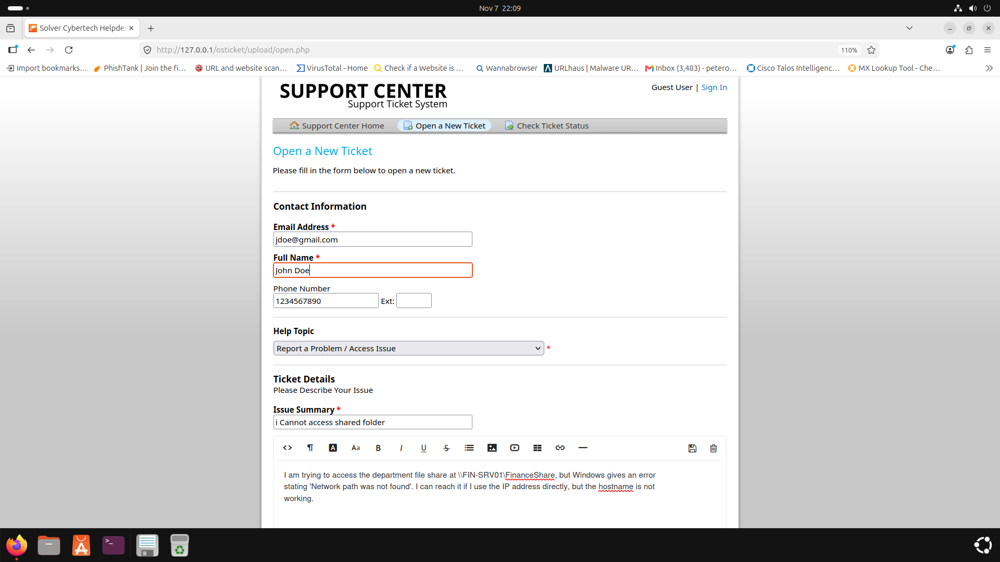
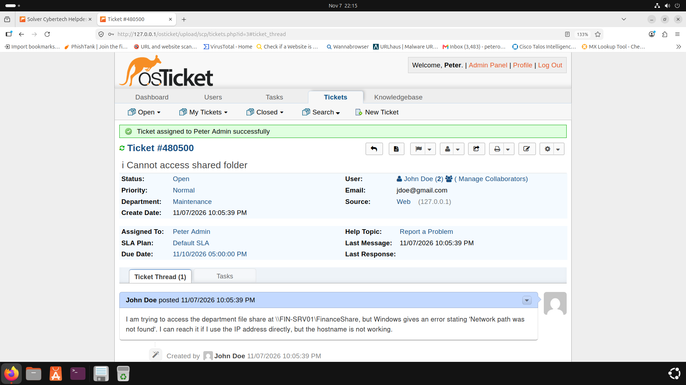
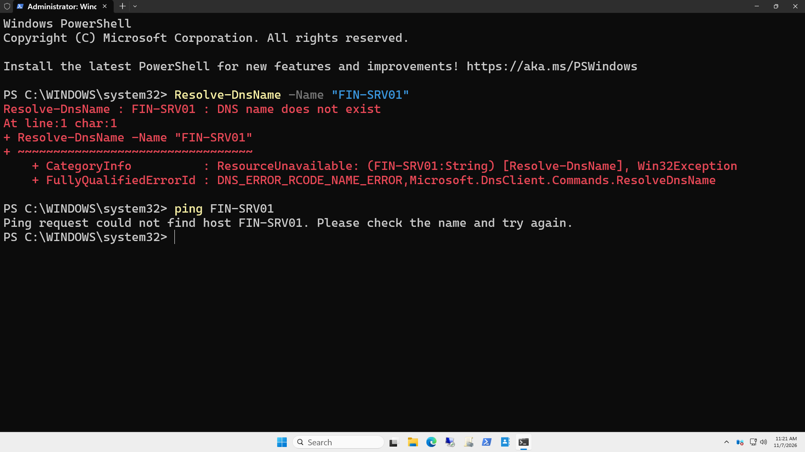
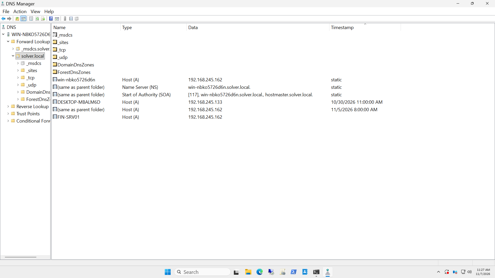
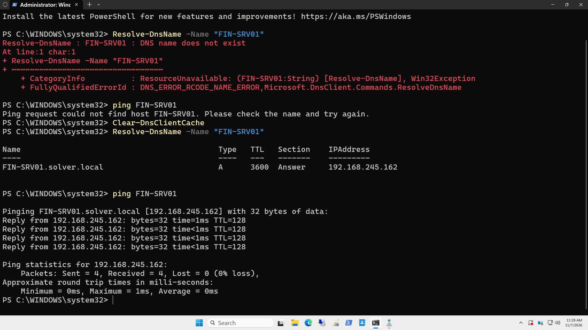
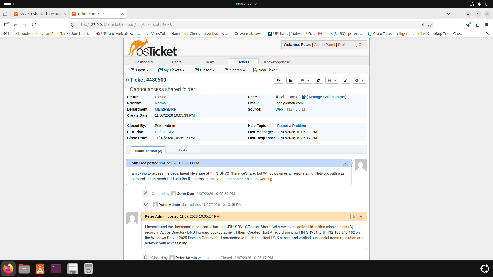

#  Enterprise DNS Resolution & Network Share Remediation Lab
**Author:** Peter Okonkwo | **Brand:** Solver Cybertech  
**GitHub:** [solver113](https://github.com/solver113)  
**LinkedIn:** [Peter Okonkwo](https://www.linkedin.com/in/peter-okonkwo-3b6610230)

---

##  CORE COMPETENCY 
**Key Practical Skills Demonstrated:**
* **Active Directory DNS Management:** Provisioned Forward Lookup Zone Host (A) records on Windows Server 2025 Domain Controller to resolve enterprise hostname failures.
* **Network & Name Resolution Triage:** Executed CLI diagnostics (`Resolve-DnsName`, `ping`, `Clear-DnsClientCache`) to isolate root causes and verify resolution.
* **End-to-End Ticket Lifecycle:** Managed real-world Tier-1/Tier-2 enterprise support workflow in osTicket from client submission to technical verification and closure.

---

##  Project Overview
This portfolio project demonstrates an enterprise IT Helpdesk workflow resolving network path accessibility and hostname resolution failures. The lab simulates a common enterprise support incident where a domain user cannot access a departmental shared folder via UNC path (`\\FIN-SRV01\FinanceShare`) due to a missing DNS Host (A) record on the Windows Server 2025 Domain Controller.

---

##  Architecture & Lab Environment
* **Virtualization:** VMware Workstation
* **Ticketing Server:** Ubuntu Server running Apache, MariaDB, and PHP (LAMP Stack) with osTicket v1.18.1
* **Domain Controller & DNS:** Windows Server 2025 running Active Directory Domain Services (AD DS) & DNS Server (`solver.local`)
* **Network Scope:** Private Internal Virtual Network (`192.168.245.0/24`)

---

## 📷 Full Workflow & Deployment Documentation

### Phase 1: Incident Creation & Triage 
- **Step 1 — Client Ticket Submission:** User *John Doe* submitted a support ticket reporting network path failure (`Network path was not found`) when attempting to reach `\\FIN-SRV01\FinanceShare`.  
  

- **Step 2 — Agent Queue Triage:** Logged into the Staff Control Panel, reviewed ticket details, and assigned the issue to the active SysAdmin queue (`peter admin`).  
  

---

### Phase 2: CLI Diagnostics & DNS Remediation 
- **Step 3 — Name Resolution Diagnostics:** Executed PowerShell commands `Resolve-DnsName -Name "FIN-SRV01"` and `ping FIN-SRV01` on the domain server, confirming a complete hostname lookup failure (`DNS name does not exist`).  
  

- **Step 4 — DNS Host (A) Record Creation:** Accessed DNS Manager (`dnsmgmt.msc`) on the Windows Server  Domain Controller, navigated to the `solver.local` Forward Lookup Zone, and provisioned a new Host (A) record mapping `FIN-SRV01` to static IP `192.168.245.162`.  
  

---

### Phase 3: Resolution Verification & Ticket Closure 
- **Step 5 — Resolver Cache Flush & Connectivity Verification:** Flushed local DNS cache using `Clear-DnsClientCache`  and re-executed `Resolve-DnsName`. Verified successful resolution to `192.168.245.140` with 0% packet loss on network ping.  
  

- **Step 6 — Ticket Resolution & Closure:** Replied to the ticket in osTicket detailing the root-cause analysis (missing Host A record in Forward Lookup Zone), confirmed UNC path access, and updated ticket status to **Closed**.  
  

---

##  Systems Administration Concepts Applied
- Isolated layer-3 IP connectivity vs. layer-7 DNS name resolution failures.
- Maintained Active Directory Forward Lookup Zone Integrity.
- Applied standard  incident management and client communication protocols.

---

**Author:** Peter Okonkwo  
**Lead Engineer & Founder, Solver Cybertech**  
**LinkedIn:** [https://www.linkedin.com/in/peter-okonkwo-3b6610230](https://www.linkedin.com/in/peter-okonkwo-3b6610230)
